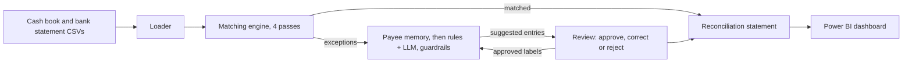

# AI Bank Reconciliation Agent

Reconciles a company's cash book against its bank statement:

1. A rules-based **matching engine** clears the lines that agree.
2. A **hybrid labeling step** labels what's left and drafts adjusting journal entries, inside guardrails. Rules settle the cases the data already decides, including **TDS** deducted from a payment; an LLM (LangChain, with a local Ollama model or OpenAI) reads the bank-only lines.
3. A **payee memory** labels recurring bank lines (auto-debits, bank charges, interest) the way a reviewer approved them last time, before any rule or model sees them.
4. A reviewer **approves, corrects or rejects** each suggested entry through a FastAPI service.
5. The results feed a **Power BI** dashboard.



## Results

The data is synthetic (see [why](#why-synthetic-data)), and the generator records the correct answer for every line, so every stage is scored against it.

**12 months, July 2025 to June 2026: 6,097 book and bank lines, 413 exceptions.**

| Stage | Result |
|---|---|
| Matching engine | 100% precision; every matchable item matched; every exception left for review |
| Exception labeling, keyword rules (baseline) | 90.1% correct (372 of 413); 33 sent to review |
| Exception labeling, LLM only (Llama 3.1 8B via Ollama) | 76.8% correct (317 of 413); 59 sent to review |
| Exception labeling, hybrid: rules + Llama 3.1 8B on bank-only lines | 95.2% correct (393 of 413); 4 sent to review |
| Keyword rules + payee memory, no LLM | 95.9% correct (396 of 413); 16 sent to review |
| **Hybrid + payee memory** | **98.3% correct (406 of 413); 4 sent to review; 85 of the 120 bank-only lines answered from memory** |

By exception type:

| Exception | Items | Rules | Rules + memory | LLM only | Hybrid | Hybrid + memory |
|---|---|---|---|---|---|---|
| Amount keyed in wrongly | 78 | 98.7% | 98.7% | 98.7% | 98.7% | 98.7% |
| Duplicate book entry | 24 | 100% | 100% | 0% | 100% | 100% |
| Deposit in transit | 65 | 100% | 100% | 18.5% | 100% | 100% |
| Outstanding payment | 126 | 100% | 100% | 100% | 100% | 100% |
| Interest credit | 12 | 100% | 100% | 100% | 100% | 100% |
| Bank charge (e.g. `LOCKER RENT`, `DD COMMISSION`) | 60 | 75.0% | 96.7% | 100% | 100% | 100% |
| Direct credit under a shortened remitter name | 24 | 50.0% | 54.2% | 87.5% | 87.5% | 87.5% |
| Unrecorded auto-debit (e.g. `AAROGYA HEALTH PLAN`) | 24 | 45.8% | 87.5% | 37.5% | 33.3% | 87.5% |

A label only counts as correct when the category, the adjustment and the journal entry all match the answer key.

**Why hybrid.** On its own, Llama 3.1 8B scored below the rules. It read cheques received from customers as cheques the company had issued (the guardrails sent these to review) and got only 12 of the 65 deposits in transit right. It also called duplicate entries timing differences, even when the evidence showed an identical entry had already cleared the bank. The guardrails can't catch that mistake, because the label is plausible. The model beat the rules only where the bank's free text has to be read: bank charges and direct credits. Amount pairs and book-only lines are decided by structured facts, so the hybrid leaves them to the rules and sends only the 120 bank-only lines to the model. This design came from the error analysis of the LLM-only run; every run uses the same 12 months.

Both LLM runs send the same prompts for bank-only lines; the one difference between them (auto-debits 9 vs 8) is run-to-run variation in the local model. The weak spot left in the hybrid is the expense account on unrecorded auto-debits: the model gets the category right for all 24 but often falls back to Miscellaneous Expense, so only 8 of the 24 journal entries are exactly right. The payee memory fixes most of these.

**Small prompt changes move the model.** Adding TDS to the prompt (one line, plus the new category in the output schema) moved the hybrid's bank-only results from 94 to 101 of 120 right, on lines that had nothing to do with TDS. The change happened to help, but it shows why the structured decisions stay in code and why every prompt change is re-measured over all 12 months.

**Why a payee memory.** Auto-debits, bank charges and interest come back every month with the same narration apart from reference numbers and dates. Once a reviewer has approved one, the memory labels the next one the same way, so it never reaches the rules or the model. Over the 12 months, with a simulated reviewer approving the right label at each month end, it answered 85 of the 120 bank-only lines. With the rules alone, that's 104 of the 120 right, against 80 for the rules and 101 for the hybrid, with no LLM at all; auto-debits go from 11 of 24 to 21 of 24. With the hybrid, the model only sees the 35 lines nobody has approved yet: 114 of the 120 right, and 406 of all 413 exceptions (98.3%), with 4 sent to review. The memory helps least with direct credits, because the bank shortens remitter names differently each time.

**TDS.** Customers often pay an invoice minus TDS (tax deducted at source), and the company deducts TDS when paying vendors. If the cash book shows the gross amount, the shortfall looks exactly like a keying error, and booking it back to the customer or vendor is wrong: the customer owes nothing more (it's a tax credit, TDS Receivable), and the vendor has been paid in full (the company owes the TDS to the government, TDS Payable). With 3 TDS settlements added to each month (`--tds 3`, 36 in all), the rules label all 36 correctly and book them to TDS Receivable or TDS Payable; before this check, all 36 were called keying errors. When a shortfall fits TDS exactly *and* the two amounts are the same digits with two swapped, the rules send it to review rather than guess. That happened once in the 78 keying errors over 12 months.

## Quick start (Windows)

```
cd C:\recon-agent
python -m venv venv
venv\Scripts\activate
pip install -r requirements.txt
python -m pytest
python -m recon.generator --out data
python -m recon.pipeline --labeler rules
```

If PowerShell blocks `activate`, skip it and run each command as `venv\Scripts\python -m ...` instead.

`python -m recon.pipeline` prints the match rate, the reconciliation statement and the scores, and writes the Power BI files to `output/`.

## Using an LLM

**OpenAI:** copy `.env.example` to `.env` and put your key after `OPENAI_API_KEY=`. `.env` is ignored by git.

```
python -m recon.pipeline --labeler openai
python -m recon.evaluate --months 12 --labeler openai --out output/eval_openai
```

**Ollama (free, runs locally):** install it from ollama.com and run `ollama pull llama3.1:8b`. Then:

```
python -m recon.evaluate --months 12 --labeler hybrid-ollama --out output/eval_hybrid   # rules + LLM (recommended)
python -m recon.evaluate --months 12 --labeler ollama --out output/eval_ollama          # LLM labels everything
```

`--labeler hybrid-openai` does the same with OpenAI. On a laptop GPU, the 12-month hybrid run takes a few minutes.

To measure the payee memory and the TDS scenario as well:

```
python -m recon.evaluate --months 12 --labeler rules --memory --out output/eval_rules_memory
python -m recon.evaluate --months 12 --labeler hybrid-ollama --memory --out output/eval_hybrid_memory
python -m recon.evaluate --months 12 --labeler rules --tds 3 --out output/eval_rules_tds
```

To use a different model, set `RECON_LLM_MODEL` in `.env` or pass `--model`.

## The API

```
uvicorn recon.api:app --reload
```

Then open http://127.0.0.1:8000/docs to try every endpoint in the browser.

| Endpoint | What it does |
|---|---|
| `POST /reconciliations` | Upload a cash book and bank statement and reconcile them |
| `POST /reconciliations/sample` | Reconcile the sample month in `data/` |
| `GET /reconciliations/{id}` | Match summary, reconciliation statement and scores |
| `GET /reconciliations/{id}/matches` | Every match and the pass that found it |
| `GET /reconciliations/{id}/exceptions` | Suggested fixes, filterable by status and category |
| `POST /reconciliations/{id}/exceptions/{ex}/approve` | Approve a suggested entry, optionally with a corrected `category` or `counter_account`; approved bank-only lines go into the payee memory |
| `POST /reconciliations/{id}/exceptions/{ex}/reject` | Reject it, with an optional note |
| `GET /reconciliations/{id}/statement` | The statement counting approved fixes only |
| `GET /payee-memory` | What the payee memory has learned, and when it was approved |

The API keeps runs in memory and has no login, so it's for local use only. The payee memory is saved to `payee_memory.json`, and every new run uses it.

## How it works

### 1. Statement generator (`recon/generator.py`)

Builds a month of cash book and bank statement for a fictional company, with realistic differences, and writes an answer key. Money is `Decimal` throughout, and every generated month reconciles to 0.00 exactly.

### 2. Matching engine (`recon/matcher.py`)

Four passes, strongest evidence first. Each line is used at most once.

| Pass | Rule | Result |
|---|---|---|
| `reference` | Shared UTR, cheque or invoice number, same amount | Matched |
| `amount_diff` | Shared reference, different amount | Flagged as a likely keying error |
| `amount_date` | Same amount within 5 days; the most similar name wins ties | Matched |
| `one_to_many` | Several book lines adding up to one bank line | Matched (batched cheque deposits) |

### 3. Labeling step (`recon/agent.py`)

The hybrid labeler routes each exception by type. Amount pairs and book-only lines go to the rules, because structured facts decide them: the direction of the money, and whether an identical entry already cleared. Bank-only lines go to the LLM, because only the bank's free text tells a bank charge from an auto-debit, or a customer's payment from interest.

Each exception the LLM sees gets an evidence pack: the line, related book lines with the same reference, the customer master and the chart of accounts. The model returns a category, an account and an explanation. Then guardrails apply to every label, from either labeler:

- Categories that are impossible for the line (for example, interest on a payment) go to review.
- Accounts must come from the chart of accounts or the customer master.
- The model has no field for amounts. Python calculates every adjustment and journal entry.
- Failed calls go to review, and every suggestion waits for approval.

### TDS (`recon/tds.py`)

A pair with a shared reference but a different amount is checked against TDS before anything else. The shortfall has to equal the TDS at one of the common rates (0.1%, 1%, 2% or 10%), worked out on the full amount or on the value before 18% GST, either to the paisa or rounded to the rupee. If it does, the rules label it `TDS_DEDUCTED` and Python books it to TDS Receivable (receipts) or TDS Payable (payments). If the two amounts are also the same digits with two swapped, both explanations fit, so it goes to review. The guardrail only lets any labeler, including the model or a reviewer's correction, call a pair TDS when the arithmetic fits.

### Payee memory (`recon/memory.py`)

Each approved bank-only label is stored against the line's direction and the words of its narration that contain no digits, so `NACH DR QRTB1234... AAROGYA HEALTH PLAN` in June and `NACH DR ZENB9876... AAROGYA HEALTH PLAN` in July share one entry. A narration with nothing but transfer words left (`NEFT CR`) is never remembered. The latest approval wins. Remembered labels go through the same guardrails and still wait for approval.

### 4. Reconciliation statement

```
adjusted book balance = book closing balance + book-side adjustments
adjusted bank balance = bank closing balance + deposits in transit - outstanding payments
```

Once the correct fixes are approved, the difference is exactly 0.00. A wrong or rejected fix leaves exactly its amount unreconciled.

## Why synthetic data

Real bank statements are confidential and don't come with the right answers. The generator makes realistic months (NEFT, RTGS, UPI, cheques, NACH, GST and TDS payments), so the matcher and the labelers can be scored honestly. All names are fictional. The matcher and the labelers never read `answer_key.csv`; only `recon/score.py` does.

## The differences it creates

| Category | Found in | What happened | Fix |
|---|---|---|---|
| `EXACT` | Both | Same amount, same day, shared reference | None |
| `DATE_LAG` | Both | The bank posted it later (NEFT batch, cheque clearing, cheque presented late) | None |
| `NO_REFERENCE` | Both | The bank narration has no shared reference and a shortened name | None, but it needs fuzzy matching |
| `BATCH_DEPOSIT` | Both | Several cheques on one deposit slip, one combined bank credit | None, but it needs a one-to-many match |
| `AMOUNT_ERROR` | Both | Two digits transposed when the entry was keyed in | Correct the book |
| `DUPLICATE_BOOK` | Book only | The same entry keyed twice | Reverse the duplicate |
| `DEPOSIT_IN_TRANSIT` | Book only | Receipt booked this month, credited by the bank next month | Timing difference: add to the bank balance |
| `OUTSTANDING_PAYMENT` | Book only | Cheque issued but not yet presented | Timing difference: deduct from the bank balance |
| `BANK_CHARGE` | Bank only | Charges debited by the bank | Book the charge |
| `INTEREST_CREDIT` | Bank only | Interest credited by the bank | Book the income |
| `UNRECORDED_DEBIT` | Bank only | A NACH auto-debit nobody booked | Book the expense |
| `DIRECT_CREDIT` | Bank only | A customer paid straight into the account | Book the receipt |
| `TDS_DEDUCTED` | Both | Paid net of TDS while the book shows the gross. Only with `--tds N` | Move the TDS to TDS Receivable or TDS Payable |

## Project layout

```
recon/generator.py   synthetic months with an answer key
recon/loader.py      reads the CSVs (references stay text, amounts become signed Decimals)
recon/matcher.py     the four matching passes
recon/agent.py       evidence, labelers (rules, LLM, hybrid) and guardrails
recon/tds.py         the TDS arithmetic and the digit-swap check
recon/memory.py      the payee memory and the labeler that answers from it
recon/score.py       scoring against the answer key, and the simulated reviewer
recon/pipeline.py    one command: match, label, statement, Power BI files
recon/evaluate.py    scores a labeler over many months
recon/api.py         FastAPI service with the approval workflow
tests/               143 tests, one file per module
data/                sample month (June 2026, seed 42)
output/              results for the sample month, used by the dashboard
powerbi/README.md    how to build the dashboard
```

## Limitations

- Synthetic data: real statements are messier (partial payments, reversals, foreign currency).
- Weekends are skipped but bank holidays are not.
- One bank account and one currency per run.
- TDS: the common rates only (0.1%, 1%, 2%, 10%), GST at 18% only, and no lower-deduction certificates.
- The payee memory matches narrations word for word once digits are removed, so a remitter name the bank shortens differently each month won't match. The evaluation's simulated reviewer always approves the right answer.
- The API is a local demo: in memory, with no authentication.
